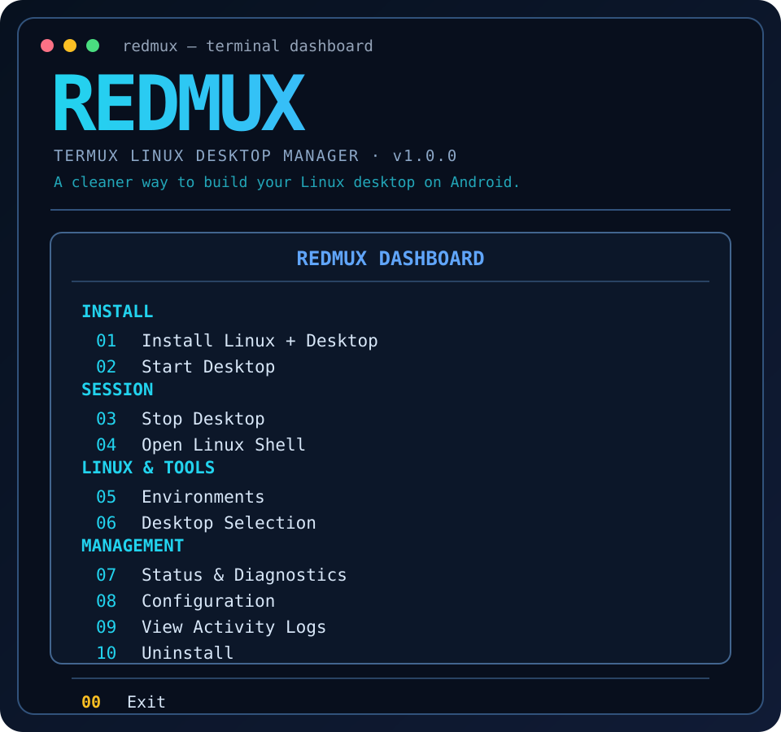

<div align="center">
  
  <h1>REDMUX</h1>
  <p><strong>Termux Linux Desktop Manager</strong></p>
  <p>A cleaner way to build and manage a Linux desktop on Android.</p>
  
  <p><strong>Version 1.0.0</strong> · Android · Termux · PRoot-Distro · Termux:X11</p>
</div>

REDMUX is a terminal-based manager for installing a Linux distribution in Termux, adding a desktop environment, and launching its graphical session through Termux:X11. It provides an interactive dashboard and direct commands for installation, sessions, configuration, diagnostics, logs, and removal.

> REDMUX does not provide a Linux kernel or a full virtual machine. Linux environments run through PRoot-Distro and inherit its compatibility limitations.

## Contents

- [Features](#features)
- [Preview and artwork](#preview-and-artwork)
- [Requirements](#requirements)
- [Installation](#installation)
- [First-time setup](#first-time-setup)
- [Commands](#commands)
- [Supported environments](#supported-environments)
- [Configuration](#configuration)
- [Files and data](#files-and-data)
- [Uninstall](#uninstall)
- [Troubleshooting](#troubleshooting)
- [Documentation](#documentation)
- [Development and testing](#development-and-testing)
- [Contributing](#contributing)
- [Disclaimer](#disclaimer)
- [License](#license)

## Features

- Interactive, single-column dashboard designed for narrow Termux terminals.
- Cyan and blue terminal styling with a plain-text fallback.
- Guided Debian, Ubuntu, and Kali Linux installation through PRoot-Distro.
- Selection of one or more desktop environments.
- Installation stages that can resume when the saved distribution and desktop selection match.
- Desktop launch and stop operations through Termux:X11.
- Optional VNC server support with localhost-only binding.
- Graphics profiles for automatic detection, software rendering, VirGL, and Turnip/Zink environments.
- Configurable display resolution and font DPI.
- PulseAudio startup when available.
- Optional Wine and Winetricks installation.
- Guest APT package search, installation, removal, and package listing.
- Curated GTK theme, icon, and font installation.
- Termux:API command-line package setup.
- X11 startup flags for software rendering, legacy drawing, and debug logging.
- Configuration, environment listing, status, diagnostics, and activity logs.
- Explicit confirmation before removing Linux distribution filesystems.

## Preview and artwork

The image above is the repository illustration at `assets/menu.svg`. GitHub renders it in this README. It is documentation artwork only: `redmux setup` does not copy it to the device, and the live dashboard is rendered by shell functions.

| File | Purpose | Installed by `redmux setup` |
| --- | --- | --- |
| `assets/logo.svg` | Project logo used in this README | No |
| `assets/menu.svg` | Dashboard preview used in this README | No |
| `assets/banner.txt` | Terminal wordmark | Yes |

## Requirements

- An Android device supported by the installed Termux build.
- A current Termux installation from a supported distribution source.
- A working network connection for package and root filesystem downloads.
- Sufficient free storage. A Linux desktop can require several gigabytes.
- The Termux:X11 Android application, installed separately.
- The Termux-side package that provides the `termux-x11` command.

REDMUX can offer to install PRoot-Distro and the Termux:X11 command-line package when they are missing. Package availability and desktop compatibility depend on the distribution release and device architecture.

## Installation

Clone the repository in Termux:

```bash
pkg update
pkg install git
git clone https://github.com/djunekz/redmux.git
cd redmux
chmod +x redmux
./redmux setup
```

The setup command installs the `redmux` launcher in `$PREFIX/bin` and copies the runtime files to `$PREFIX/share/redmux`. It copies `assets/banner.txt`, but does not copy the README, SVG artwork, or other documentation.

To run directly from the source checkout without installing the launcher:

```bash
bash redmux
```

## First-time setup

1. Run `redmux` to open the dashboard.
2. Select **Install Linux + Desktop**.
3. Choose Debian, Ubuntu, or Kali Linux.
4. Select one or more desktop environments.
5. Review the installation plan and allow each package operation to finish.
6. Install and open the Termux:X11 Android application.
7. Run `redmux start` to launch the configured desktop.

Keep Termux open while package installation is running. Do not interrupt APT or dpkg while packages are being configured. If installation is interrupted, run `redmux install` again. Completed stages are reused only when the saved distribution and desktop selection match.

## Commands

| Command | Description |
| --- | --- |
| `redmux` or `redmux menu` | Open the interactive dashboard |
| `redmux setup` | Install or refresh the launcher and runtime files |
| `redmux install` | Install or resume Linux and desktop setup |
| `redmux start [distro] [options]` | Start a selected desktop session |
| `redmux stop` | Stop the REDMUX-managed desktop session and its managed X11 process |
| `redmux restart` | Stop and start the configured desktop session |
| `redmux shell [distro]` | Open a shell inside a Linux distribution |
| `redmux environments` | List PRoot-Distro environments |
| `redmux desktop` | Select the default desktop environment |
| `redmux status` | Display configuration and session status |
| `redmux config` | Open configuration options |
| `redmux diagnose` | Check dependencies, storage, and graphics capabilities |
| `redmux graphics` | Inspect detected graphics helpers and rendering profile |
| `redmux apps search QUERY` | Search guest APT packages |
| `redmux apps install PACKAGE` | Install guest packages |
| `redmux apps remove PACKAGE` | Remove guest packages |
| `redmux apps list` | List installed guest packages |
| `redmux themes install` | Install curated themes and icons |
| `redmux wine-install` | Install Wine and Winetricks |
| `redmux wine-run FILE.exe` | Run a Windows executable through Wine |
| `redmux api-install` | Install the Termux:API CLI package |
| `redmux autostart enable` | Create a Termux:Boot startup entry |
| `redmux config export PATH` | Export validated settings |
| `redmux config import PATH` | Import validated settings |
| `redmux reset` | Reset settings without deleting Linux environments |
| `redmux gui --start x11` | Start the X11 desktop |
| `redmux gui --start vnc` | Start the VNC desktop |
| `redmux gui --kill` | Stop REDMUX-managed X11 and configured VNC sessions |
| `redmux tx11start` / `redmux tx11stop` | Termux:X11 startup and stop aliases |
| `redmux vncstart` / `redmux vncstop` | VNC startup and stop aliases |
| `redmux start --nogpu --legacy` | Start with software rendering and legacy X11 drawing |
| `redmux vnc-install` | Install the optional guest TigerVNC server |
| `redmux vnc-start [distro]` | Start the configured VNC desktop |
| `redmux vnc-stop [distro]` | Stop the configured VNC display |
| `redmux vnc-status [distro]` | List VNC sessions |
| `redmux logs` | Display recent REDMUX logs |
| `redmux uninstall` | Open the guarded removal workflow |
| `redmux version` | Print the installed version |
| `redmux help` | Display command help |

The dashboard accepts options `01` through `10`. Enter `00` or `0` to exit; single-digit choices are also accepted.

`redmux stop` only targets the process started and recorded by REDMUX. If the session was started outside REDMUX or its process record is missing, stop that session using the relevant environment's own controls. REDMUX does not terminate unrelated desktop processes by name.

## Supported environments

### Linux distributions

- Debian
- Ubuntu
- Kali Linux

### Desktop environments and window managers

- XFCE4
- KDE Plasma
- LXQt
- MATE
- LXDE
- GNOME
- Openbox
- i3
- Cinnamon
- dwm
- bspwm
- Awesome
- Fluxbox
- IceWM
- Window Maker

Package names, installation checks, and launch commands are defined in `core/desktop.sh`. PRoot compatibility varies. Some desktop components expect systemd, logind, kernel features, or background services that PRoot cannot fully provide. XFCE4 is a practical lightweight starting point, but compatibility must be checked on the target device.

## Graphics and VNC

REDMUX provides `auto`, `software`, `virgl`, and `turnip` graphics profiles. Use `redmux graphics` to inspect detected helpers and the selected profile. Detection does not guarantee hardware acceleration; validate rendering on the target device.

Optional VNC support is available with `redmux vnc-install`, `redmux vnc-start`, `redmux vnc-status`, and `redmux vnc-stop`. Configure a password inside the Linux guest with `vncpasswd`. REDMUX requests localhost-only VNC binding.

`redmux start` also accepts `--desktop KEY` or `--xstartup KEY`, `--nogpu`, `--legacy`, and `--debug`. Optional boot startup uses Termux:Boot: run `redmux autostart enable` after installing the Termux:Boot Android application.

## Configuration

Open the configuration menu:

```bash
redmux config
```

The user configuration file is:

```text
~/.config/redmux/redmux.conf
```

| Setting | Default | Description |
| --- | --- | --- |
| `REDMUX_DISTRO` | `debian` | Default Linux distribution |
| `REDMUX_DESKTOP` | `xfce` | Default desktop environment |
| `REDMUX_DESKTOPS` | `xfce` | Comma-separated configured desktop environments |
| `REDMUX_DISPLAY` | `:1` | Termux:X11 display identifier |
| `REDMUX_RESOLUTION` | Empty | Requested X11 framebuffer size |
| `REDMUX_DPI` | Empty | Optional Xft and Qt font DPI |
| `REDMUX_GPU_MODE` | `auto` | `auto`, `software`, `virgl`, or `turnip` |
| `REDMUX_VNC_DISPLAY` | `:2` | Optional VNC display |
| `REDMUX_VNC_RESOLUTION` | `1280x720` | VNC virtual display size |
| `REDMUX_VNC_DEPTH` | `24` | VNC color depth: 16, 24, or 32 |
| `REDMUX_X11_LEGACY` | `0` | Enable Termux:X11 legacy drawing mode |
| `REDMUX_X11_DEBUG` | `0` | Log Termux:X11 startup output |

Use `redmux config` to change supported values. REDMUX reads only recognized assignments and validates their values; it does not execute the configuration file as shell code.

## Files and data

| Path | Purpose |
| --- | --- |
| `~/.config/redmux/redmux.conf` | User configuration |
| `~/.local/share/redmux/install.state` | Resumable installer state |
| `~/.local/share/redmux/session.pid` | Active REDMUX-managed session process ID |
| `~/.local/share/redmux/session.group` | Whether the session was started in its own process group |
| `~/.local/share/redmux/x11.pid` | REDMUX-managed Termux:X11 process ID |
| `~/.local/share/redmux/graphics.pid` | REDMUX-managed VirGL helper process ID |
| `~/.local/state/redmux/redmux.log` | Activity log |
| `$PREFIX/share/redmux/` | Installed runtime files and terminal banner |
| `$PREFIX/bin/redmux` | Command launcher |

The source checkout is separate from the installed copy. Removing the installed application does not delete the source checkout.

## Uninstall

The uninstall workflow distinguishes between removing REDMUX and removing Linux environments. Removing a distribution deletes its installed packages and user data inside that environment. Back up important files first and read every confirmation prompt carefully. Full environment removal requires typing the exact confirmation phrase.

## Troubleshooting

Collect the following information first:

```bash
redmux version
redmux status
redmux diagnose
redmux logs
proot-distro list
```

See [Troubleshooting](docs/TROUBLESHOOTING.md) for recovery steps. Remove usernames, private paths, tokens, and other sensitive details before sharing diagnostic output.

## Documentation

- [Installation guide](docs/INSTALLATION.md)
- [Command reference](docs/COMMANDS.md)
- [Configuration reference](docs/CONFIGURATION.md)
- [Architecture](docs/ARCHITECTURE.md)
- [Termux:X11 setup](docs/TERMUX-X11.md)
- [Troubleshooting](docs/TROUBLESHOOTING.md)
- [Testing guide](docs/TESTING.md)
- [Quality checks](docs/QUALITY-CHECKS.md)
- [Project structure](docs/PROJECT-STRUCTURE.md)
- [Release checklist](docs/RELEASE-CHECKLIST.md)
- [Desktop definitions](desktops/README.md)
- [FAQ](FAQ.md)
- [Roadmap](ROADMAP.md)
- [Changelog](CHANGELOG.md)
- [Contributing](CONTRIBUTING.md)
- [Security policy](SECURITY.md)
- [Support](SUPPORT.md)
- [Code of Conduct](CODE_OF_CONDUCT.md)

## Development and testing

Run the checks from the repository root:

```bash
find . -type f \( -name '*.sh' -o -name redmux \) -print0 | while IFS= read -r -d '' file; do bash -n "$file" || exit 1; done
bash tests/test-ui.sh
bash tests/test-config.sh
bash tests/test-setup.sh
bash tests/test-session-safety.sh
```

The automated checks cover shell syntax and dashboard layout. They do not prove that package installation, Android app integration, or a desktop session works on a physical device. See [Testing](docs/TESTING.md) before making a release.

## Contributing

Bug reports, device compatibility notes, documentation fixes, and focused pull requests are welcome. Use the GitHub issue templates when reporting a bug or proposing a feature. Include reproducible steps and relevant diagnostics, with private information removed.

## Disclaimer

REDMUX is an independent community project and is not affiliated with or endorsed by the Termux, PRoot-Distro, Debian, Ubuntu, Kali Linux, or Termux:X11 maintainers. Linux distributions, desktop environments, and supporting applications remain the property of their respective projects. Use at your own risk and keep backups of important data.

## License

REDMUX is released under the MIT License. See [LICENSE](LICENSE).
